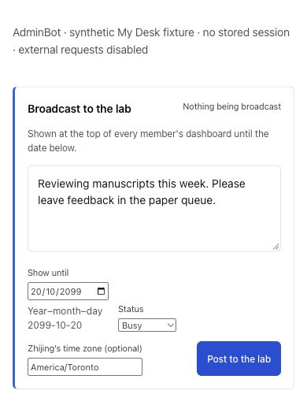
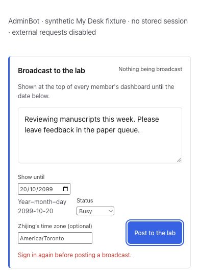

# Broadcast failure evidence

Captured 2026-10-13 using actual production `renderProfessorView`, `publishAdminBotBroadcast`, session loading and CSS with a synthetic empty My Desk. External fetches were disabled and the observed attempted-request counter remained zero. No stored member session, backend, live broadcast, external message or model call was used.

Before controller: origin/main da60b0b3. After controller: this commit, integrated with the same main. Click Post with the same synthetic message, 2099 expiry, Busy status and America/Toronto text: main silently returns; the repair renders an existing role=alert notice, preserves the draft and leaves the button usable. Both pointer and Enter activation were checked. This is a missing-session reproduction, not a diagnosis of the original unprovided live screenshot. Unexpected request rejection is covered by focused tests, not a browser-injected success/error state.

Matched viewport/theme/data: iPhone 14 390×844/light and desktop 1280×720/dark. These unaltered native JPEGs are document-origin clips containing the entire composer and fixture caption. Clip heights follow the card’s added alert (mobile before500/after530; desktop before400/after432), so there is no unrelated cut-off neighboring queue. Mobile has no page horizontal overflow. Native saved images were inspected; the PR records rendered-destination verification after pushing. Desktop links should be opened full-size.

Before, click returns without a notice:

After, Enter shows the sign-in notice and retains the typed message:

[Desktop before](broadcast434-desktop-before.jpg) · [Desktop after](broadcast434-desktop-after.jpg)

No authenticated/live save, production speed, permission expansion or deployment claim. Existing server admin-only publish/member-read behavior remains covered by the HTTP suite. The original live click and its image remain unverified; keep that limitation distinct from these reproduced silent controller paths.
