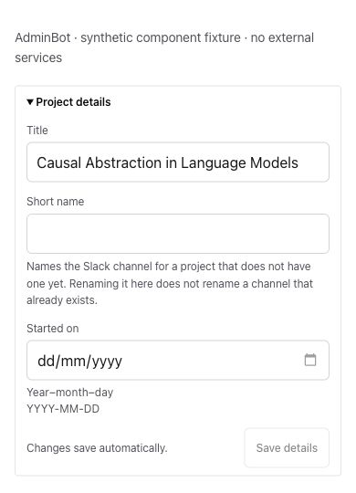
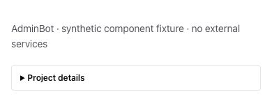
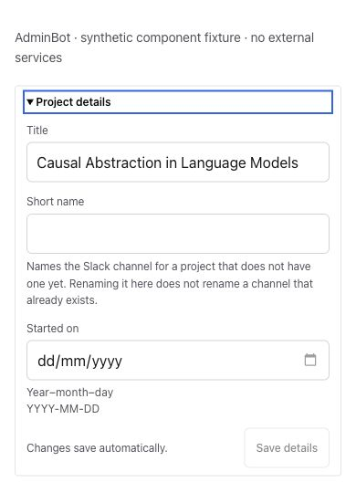
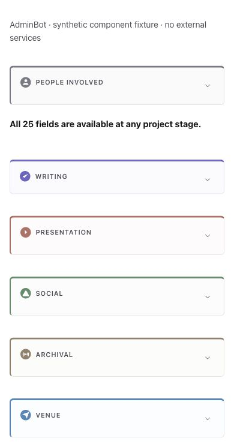
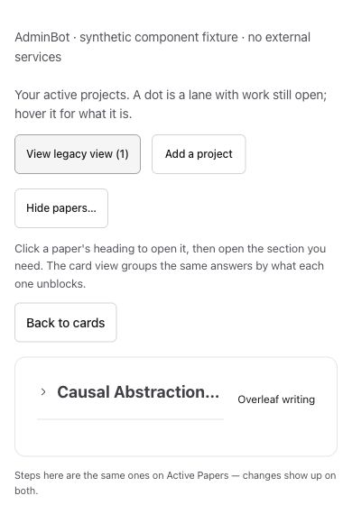
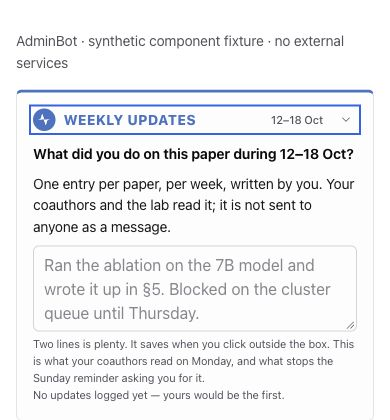
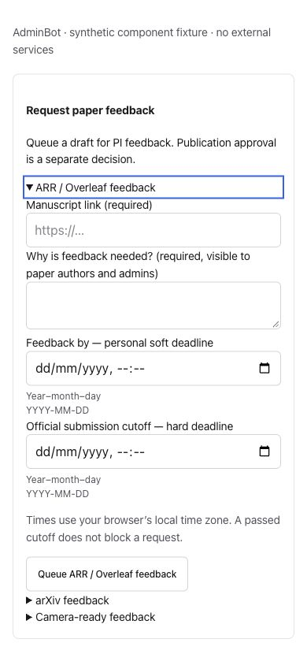
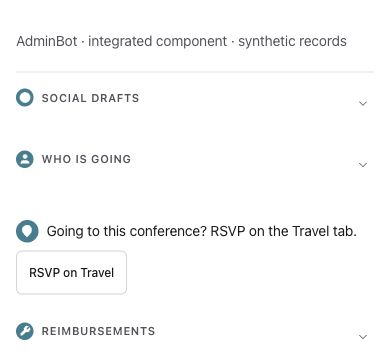

# Integrated default-collapse evidence

Actual production components and CSS with synthetic records; captured on 2026-10-13 at iPhone 14 390×844/light and desktop 1280×720/dark. These are component/workspace fixtures, not authenticated production sessions. Saves, external messages, model calls and service executors were disabled. Images are unaltered native JPEG browser captures, with context clips where useful.

The Project details baseline is b03aa42f, after integrating main da60b0b3; it still opened automatically. The matching after and keyboard-open captures use the same data, light theme and mobile viewport with the one-line default fix. Before/open clips are 390×540; the collapsed detail clip is 390×155 to avoid unused space. Other current captures use the final UI code in this commit. Cycle captures were taken on b03aa42f: those component sources are unchanged by the Project details fix.

## Project details

Before: automatically expanded on the new Project page.

After: starts collapsed.

Enter opens the editable form; a focused regression also verifies reader expansion survives a rerender and can be closed again.

## Other affected surfaces

Checklist: People involved and all five branches start closed; People/Writing can be opened independently.

Workspace legacy view: initial paper folded, stage visible despite a long title; the full accessible title is retained. Opening a paper leaves its seven groups closed. The Project group opens independently.

Weekly update: initially collapsed; keyboard expansion reveals the complete editable form.

ARR feedback: all three headings initially closed; keyboard expansion opens ARR alone. No request submitted.

Social, attendance and reimbursement sections stay folded, with the Travel RSVP action visible. Attendance opens independently. Its navigation callback was checked without any external write.

Desktop/dark context: the Active papers board starts closed, and opening it leaves the per-person rows folded. The separate overview screenshot shows a deliberately expanded person row. Its wide table retains its existing horizontal scrolling; no mobile table-redesign claim. Desktop images are best opened at full size.

[Admin board, closed](collapse450-current-admin-desktop-dark-closed.jpg) · [Overview, person opened](collapse450-current-overview-desktop-dark-open.jpg) · [Cycle, dark](collapse450-integrated-cycle-desktop-dark.jpg)

All published saved images were inspected at native size. Rendered PR inspection and exact-head CI are recorded in the PR body after pushing. No screenshot establishes live persistence, production speed or deployment. The previous directory-level evidence is historical and is labelled separately.
