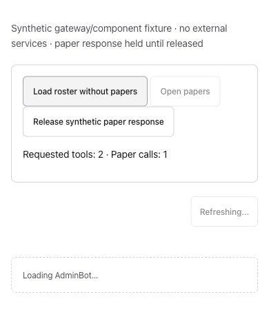
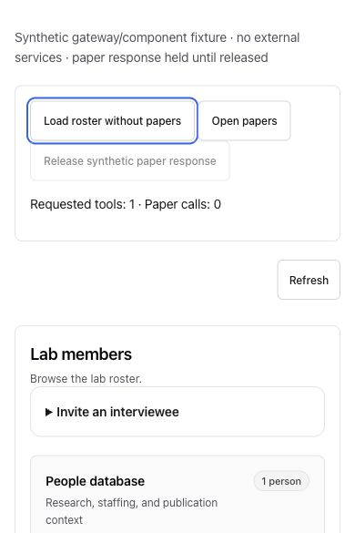

# On-demand loading: gateway evidence slice

Captured 2026-10-13 using the actual production `loadAdminBot`, `renderAdminBot` and CSS, with a synthetic gateway client, one made-up member and one paper. No authenticated production session, gateway socket, backend/model call or external mutation. The fixture’s control card and request counter are test instrumentation; the loading indicator, roster and paper page are real production components.

Before: controller copied from main da60b0b3. After: integrated PR430 code (dafbc25c; subsequent app-render edit is whitespace-only). All requested non-paper reads resolve immediately; an incorrectly requested paper read stays pending until the fixture’s explicit release action. This establishes a dependency/request-count difference, not a production speedup or an elapsed-time benchmark.

- General gateway mode: a non-paper load requests two tools/one paper on main and remains Loading AdminBot. After the change it requests one tool/zero papers and renders the roster without releasing any paper response.
- Admin gateway mode: corresponding counts are six tools/one paper before, five tools/zero papers after. The roster completes while the unnecessary paper response would still be held.
- Opening the synthetic paper page afterward requests papers on demand. Releasing its controlled response shows the paper title through the actual renderer. Pointer and Enter activation checked. Member/admin mode, empty initial state and long title checked; mobile has no outer-page overflow. Wide roster columns retain their existing horizontal scrolling.

Matched data/theme/viewport within each pair: iPhone14 390×844/light, desktop1280×720/dark. Unaltered native JPEG document-origin clips; after clips show the resulting roster, so their height differs from the compact pending state. Mobile before450/after585px; desktop before450/after720px. A clipped working mobile frame was rejected and recaptured. Every published saved file was visually inspected at native size. Rendered-PR status is recorded in the body after pushing.

[Admin gateway before](loading430-gateway-admin-desktop-before.jpg) · [Admin gateway after](loading430-gateway-admin-desktop-after.jpg)

This is partial browser coverage for PR430. Signed-in REST queue overlap, actual View-as navigation and session-change/error browser scenarios still need their own evidence. Their focused regression tests passed, but these gateway captures do not verify them. No all-page load-time, authenticated persistence, production deployment or 10,000-user readiness claim.
