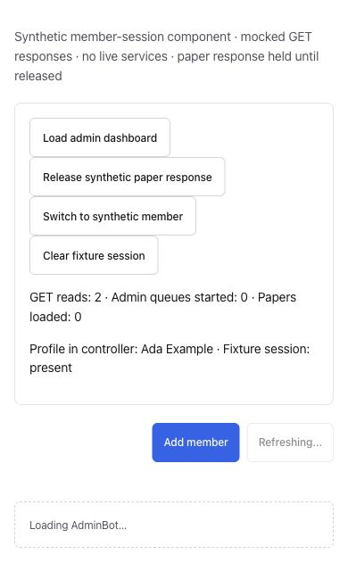
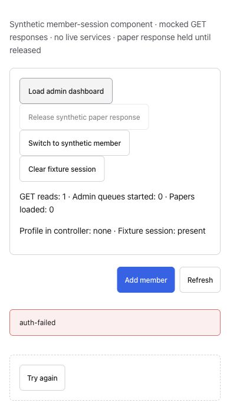

# On-demand loading: browser evidence

Captured 2026-10-13 using the actual production `loadAdminBot`, `renderAdminBot` and CSS, with a synthetic gateway client, one made-up member and one paper. No authenticated production session, gateway socket, backend/model call or external mutation. The fixture’s control card and request counter are test instrumentation; the loading indicator, roster and paper page are real production components.

Before: controller copied from main da60b0b3. After: integrated PR430 code (dafbc25c; subsequent app-render edit is whitespace-only). All requested non-paper reads resolve immediately; an incorrectly requested paper read stays pending until the fixture’s explicit release action. This establishes a dependency/request-count difference, not a production speedup or an elapsed-time benchmark.

- General gateway mode: a non-paper load requests two tools/one paper on main and remains Loading AdminBot. After the change it requests one tool/zero papers and renders the roster without releasing any paper response.
- Admin gateway mode: corresponding counts are six tools/one paper before, five tools/zero papers after. The roster completes while the unnecessary paper response would still be held.
- Opening the synthetic paper page afterward requests papers on demand. Releasing its controlled response shows the paper title through the actual renderer. Pointer and Enter activation checked. Member/admin mode, empty initial state and long title checked; mobile has no outer-page overflow. Wide roster columns retain their existing horizontal scrolling.

Matched data/theme/viewport within each pair: iPhone14 390×844/light, desktop1280×720/dark. Unaltered native JPEG document-origin clips; after clips show the resulting roster, so their height differs from the compact pending state. Mobile before450/after585px; desktop before450/after720px. A clipped working mobile frame was rejected and recaptured. Every published saved file was visually inspected at native size. Rendered-PR status is recorded in the body after pushing.

[Admin gateway before](loading430-gateway-admin-desktop-before.jpg) · [Admin gateway after](loading430-gateway-admin-desktop-after.jpg)

## Member-session REST slice, October 14

Baseline: exact main `0fb5047f95abeee3ca8fa5ab67305d923ad3a56a` controller. After: integrated code `ec5565f7a6555887c6c3fe79412c71d678c3bf3c`. The newest main chat changes were merged normally without conflicts. Gateway controller/component/style sources used in the October 13 captures did not change, so those captures remain applicable.

Actual production `loadAdminBot`, member-session storage/read APIs, `renderAdminBot` and CSS ran with synthetic Ada/Beta profiles on a dedicated loopback origin. All fetches were mocked GET responses; writes were rejected. No production authentication, backend, model or external mutation. The test control card and counters are instrumentation. The renderer stayed in admin mode; its inert controls do not establish member authorization or actual View-as navigation.

With the required paper response held, baseline starts two reads (self and papers), zero admin queues. Integrated code starts eight reads, including all six independent admin queues. The self profile is present in both controllers. The roster still shows Loading AdminBot until the required paper read completes in both versions: this proves concurrency, not earlier REST roster rendering or measured production latency. Releasing papers completes the head roster with one member/one paper.

[REST before, desktop/dark](session/loading430-session-desktop-before.jpg) · [REST after, desktop/dark](session/loading430-session-desktop-after.jpg)

While Ada's paper response is pending, saving the synthetic Beta session and loading general mode requests only the new self profile. Releasing Ada's old response leaves Beta and zero papers intact. This exercises the real session-change guard, but is not the actual View-as control flow.

[Session-change result, desktop/light](session/loading430-session-change-after.jpg)

Explicit structured 503 errors on all six optional queues still finish the required member/paper data with loading false. A structured 503 self-profile error stops after one read, displays the existing `auth-failed` notice and Try again control, and makes no paper/queue requests. A preliminary unstructured 503 fixture used the intentional synthetic offline cache fallback; it was corrected to an explicit service error before accepting failure evidence.

Matched REST pair data/theme/viewport: iPhone14 390×844/light, desktop1280×720/dark. Unaltered native JPEG document-origin clips: mobile pairs390×640, desktop pairs920×450, session-change920×819, required-error390×710. The first error clip cut the retry control and was rejected/recaptured. All six final saved images were visually inspected at native size. Synthetic session was cleared with readback, viewport reset, temporary tab/server closed and fixture files removed.

Validation on integrated main: 283 tests in six focused suites, plus complete backend/production UI build in 29.5s. No application source changes after this build; added screenshots and documentation only. Actual View-as navigation and its route behavior still need styled browser evidence before PR430 leaves draft. No all-page load-time, authenticated persistence, deployment or 10,000-user readiness claim.
