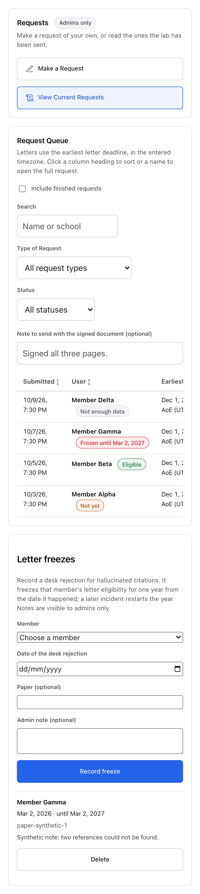
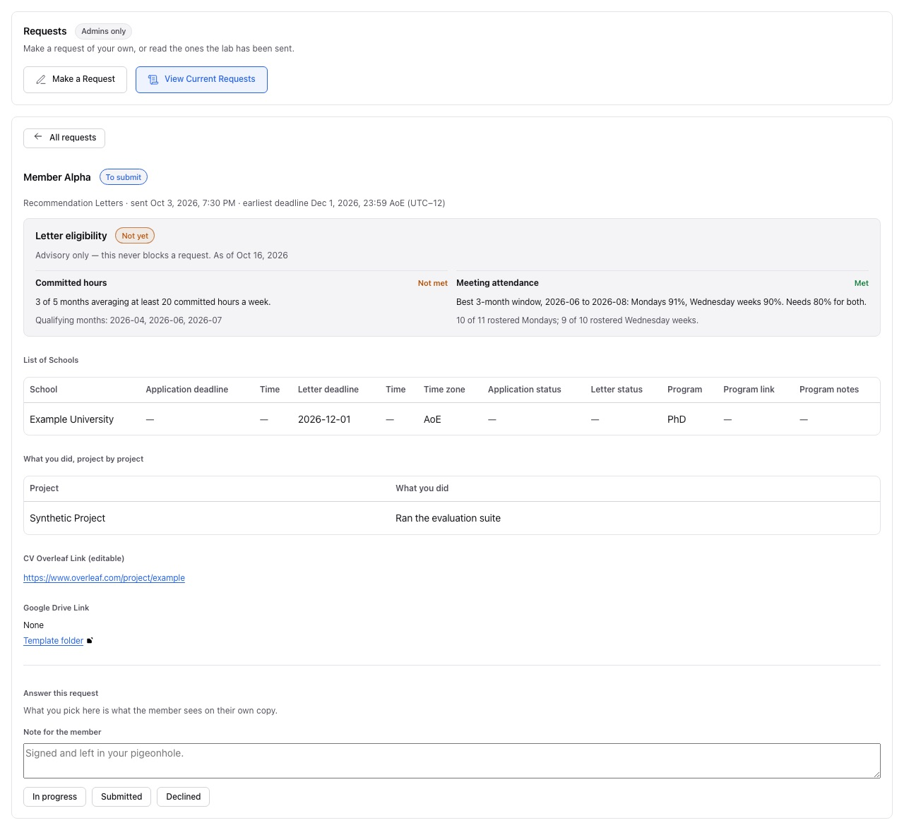
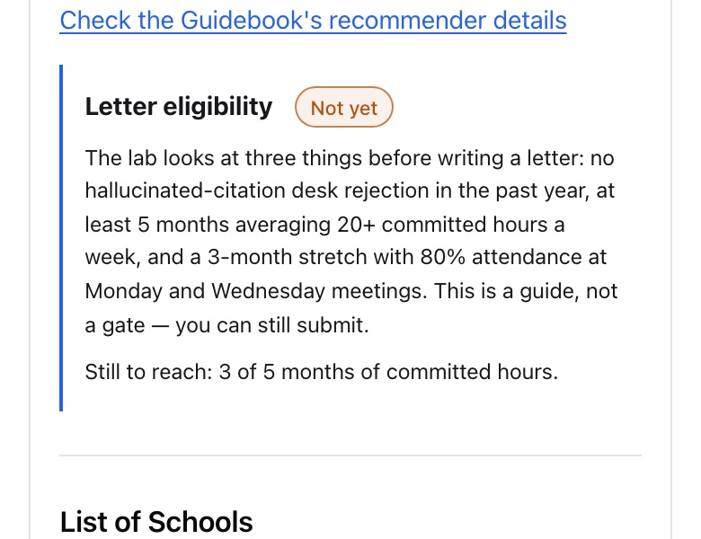

# Recommendation-letter eligibility evidence

Captured 2026-10-16 with a throwaway harness (not committed) that calls the production
`renderAdminBotLogistics` with the production stylesheet, served by the UI's Vite dev server on
127.0.0.1. Synthetic members only (Member Alpha to Delta), no backend, no stored session, and every
request off 127.0.0.1 was blocked. Light theme. Desktop 1280×800; mobile 390×844 at 2x.

"Before" renders the same props without the new optional ones (`queue.eligibility`,
`requests.eligibilityPanel`, `letters.eligibility`, `freezeAdmin`). Every UI change on this branch
is behind one of those props, so the before frames are what `main` draws for the same data. No page
had horizontal overflow at either width.

The member form shots are clipped to the guide's last link and the note below it, so the guide's
fixed contact copy above is not in the evidence.

| View                                                 | Desktop                                                                 | Mobile                                                                |
| ---------------------------------------------------- | ----------------------------------------------------------------------- | --------------------------------------------------------------------- |
| Admin queue: badges, and the freeze records below it | [before](queue-desktop-before.jpg) · [after](queue-desktop-after.jpg)   | [before](queue-mobile-before.jpg) · [after](queue-mobile-after.jpg)   |
| Request detail: eligibility panel                    | [before](detail-desktop-before.jpg) · [after](detail-desktop-after.jpg) | [before](detail-mobile-before.jpg) · [after](detail-mobile-after.jpg) |
| Member letters form: advisory note                   | [before](form-desktop-before.jpg) · [after](form-desktop-after.jpg)     | [before](form-mobile-before.jpg) · [after](form-mobile-after.jpg)     |

